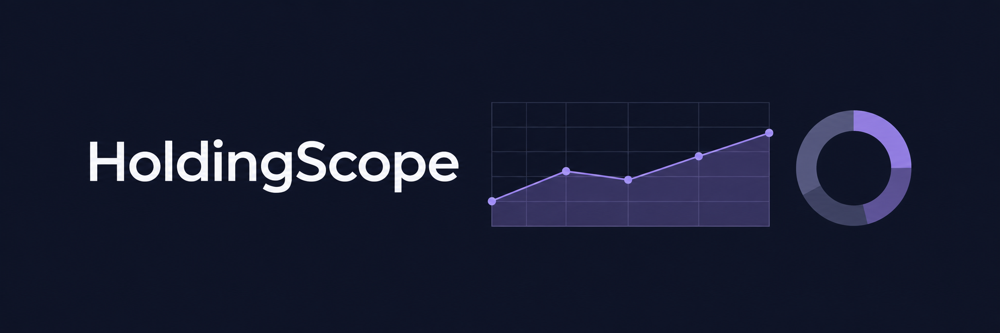
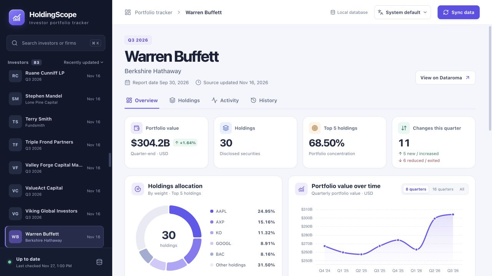

**English** · [简体中文](README.zh-CN.md)

# HoldingScope

HoldingScope is a local desktop app for following investors tracked by Dataroma. Browse their disclosed holdings, see how their portfolios are allocated, and compare changes across quarters. [Dataroma investor directory](https://www.dataroma.com/m/managers.php)

## Screenshot



## Features

- **Investor directory.** Search by English or Chinese name and see each portfolio’s reporting quarter and latest source update.
- **Portfolio dashboard.** See position weights, sector allocation, portfolio value over time, and detailed holdings. Sort by ticker, weight, shares, quarter-end price, or position value.
- **Quarterly activity and comparison.** Browse new positions, increases, reductions, and exits. Compare weights across quarters. Complete local snapshots also support share-count comparisons. Other historical quarters use Dataroma’s published top 20 holdings.
- **Local data and offline access.** The app loads saved data on startup, then checks Dataroma for changes. Opening a portfolio for the first time downloads its holdings, activity, and history. Cached portfolios refresh in the background when Dataroma posts an update. Downloaded portfolios remain available offline. [RSS feed](https://feeds.feedburner.com/dataroma) · [Update list](https://www.dataroma.com/m/home.php)
- **English and Simplified Chinese.** The app follows the system WebView’s preferred language on first launch. Chinese preferences use Simplified Chinese. All other preferences use English. The toolbar lets you change the language and remembers your choice.

## Run locally

Install Node.js, Rust, and the Tauri 2 prerequisites for your platform. Run the following commands from the repository root. [Tauri 2 prerequisites](https://v2.tauri.app/start/prerequisites/)

```sh
npm ci
npm run tauri dev
```

Run `npm run tauri build` on the target operating system to package the app. The bundles are written to `src-tauri/target/release/bundle/` by default. The build remaps local source paths in the Rust executable.

## Data and localization

The Rust backend parses Dataroma’s RSS feed and public portfolio pages, follows pagination for large holdings lists, and saves data to `holdingscope.sqlite3` in the operating system’s application data directory. The React frontend reads this data through Tauri commands and renders charts locally with Apache ECharts.

Investor translations ship with the app and are keyed by Dataroma ID. Local dictionaries cover sector names and commonly translated issuers. Names without a supplied translation appear as published by the source. Both languages share the same SQLite snapshots.

## Verify

```sh
npm run build
cargo test --locked --manifest-path src-tauri/Cargo.toml
cargo test --locked --manifest-path src-tauri/Cargo.toml live_dataroma -- --ignored --nocapture
```

The last command uses live Dataroma endpoints to verify parsing of the directory, holdings, activity, and history.

## License

[MIT](LICENSE)
