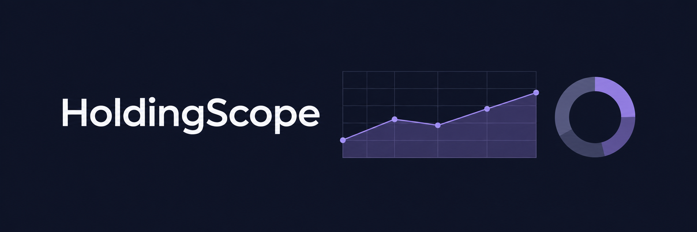
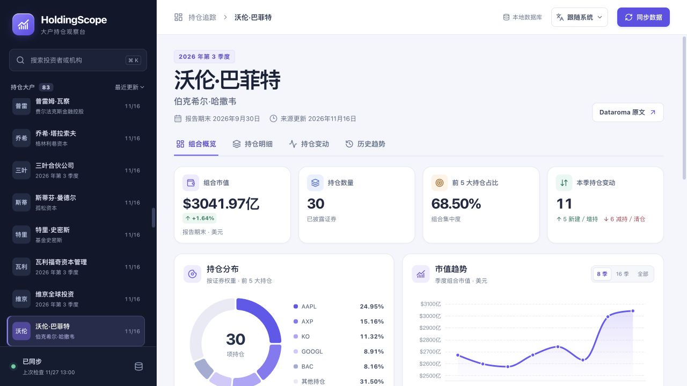

[English](README.md) · **简体中文**

# HoldingScope

HoldingScope 是一款本地桌面应用，用于追踪 Dataroma 收录的投资者。你可以查看已披露的持仓和组合分布，并比较不同季度的变化。 [Dataroma 投资者目录](https://www.dataroma.com/m/managers.php)

## 界面截图



## 功能

- **投资者目录。** 支持用中英文名称搜索，可查看各组合的报告季度和来源更新时间。
- **组合仪表盘。** 查看证券权重、行业分布、历史市值和完整持仓。持仓表可按证券代码、权重、股数、期末价格或持仓市值排序。
- **季度变动与对比。** 浏览新建、增持、减持和清仓记录，对比不同季度的权重。两个季度都有本地完整快照时，还可以比较持有股数。其余历史季度使用 Dataroma 公布的前 20 大持仓。
- **本地存储和离线访问。** 启动时先读取本地数据，再向 Dataroma 检查变更。首次打开某个组合时下载持仓、变动和历史数据，检测到来源更新后，已缓存的组合会在后台刷新。已下载的组合可离线查看。 [RSS 订阅](https://feeds.feedburner.com/dataroma) · [更新列表](https://www.dataroma.com/m/home.php)
- **英文和简体中文。** 首次启动时读取系统 WebView 的首选语言。中文首选项使用简体中文，其余语言使用英文。可在工具栏切换语言，选择会保存在本机。

## 本地运行

安装 Node.js、Rust 和对应平台的 Tauri 2 系统依赖，然后在仓库根目录运行以下命令。 [Tauri 2 系统依赖](https://v2.tauri.app/start/prerequisites/)

```sh
npm ci
npm run tauri dev
```

在目标操作系统上运行 `npm run tauri build` 打包。产物默认位于 `src-tauri/target/release/bundle/`。打包时会将 Rust 可执行文件中的本机源码路径替换为通用路径。

## 数据与本地化

Rust 后端解析 Dataroma 的 RSS 和公开组合页面，自动读取大组合的全部持仓分页，并将数据保存到系统应用数据目录下的 `holdingscope.sqlite3`。React 前端通过 Tauri commands 查询数据，由 Apache ECharts 在本机绘制图表。

投资者中文名按 Dataroma ID 随应用发布，行业译名和常见发行人译名使用本地词表。尚无译名时显示来源原文。两种语言共用同一份 SQLite 快照。

## 验证

```sh
npm run build
cargo test --locked --manifest-path src-tauri/Cargo.toml
cargo test --locked --manifest-path src-tauri/Cargo.toml live_dataroma -- --ignored --nocapture
```

最后一条命令会访问 Dataroma 的公开数据源，验证目录、持仓、季度变动和历史数据能否正常解析。

## 许可证

[MIT](LICENSE)
